# CLAVE-AD

**Claim-Level Audit and Verification of Explanations for Anomaly Detection**

CLAVE-AD splits a vision-language model's (VLM) explanation of an industrial defect into three claims (existence, location and type) and checks each claim with tools that are independent of the VLM: a CLIP-based anomaly score, an anomaly map and a per-type example library. Explanations that fail verification are re-queried once with a zoomed-in view of the suspect region. The method needs no training and no ground-truth masks at inference time.

All numbers come from the runs recorded below and live only in `results/**/*.json`.

## Key findings

- The external verification score separates fully faithful explanations from the rest better than the VLM's own confidence on both datasets and better than self-verification on MVTec AD, and this held for a second VLM from a different family.
- A zoom-in re-query whose answer is adopted only when the re-verification score rises improves explanation faithfulness (pre-specified as the primary analysis on the second VLM).
- A template built from the detector alone was the most faithful on MVTec AD, so the main claim is limited to the discriminative power of the verification score.

## Results

The figures below are generated by `scripts/analysis/report.py` from the result files listed in `configs/analysis/report.yaml` (git commit 392cd75) and copied to `docs/figures/`. They show aggregates only, no dataset images. The text gives directions; the values are in the figures and the result files. MVTec AD is the main benchmark and VisA the cross-check. Error bars are stratified bootstrap 95% confidence intervals.

Methods: B0 image only, B1 with a normal reference image, B2 with the anomaly map as an extra image, B3 VLM self-verification, B4 a template explanation from detector outputs alone (no VLM), P0 external verification of the B0 answer, P1 P0 plus a zoom-in re-query whose answer is always adopted, P1-sec the re-query answer adopted only when the re-verification score rises. B0, B3 and P0 share the same answers, so they differ only in the signal used to rank them.

### Are VLM explanations trustworthy?

The existence claim is right most often and the type claim least often: the weak point of VLM explanations is the defect type, not the judgement. Many explanations judge a defective image correctly but give a wrong location or type, so judgement accuracy alone does not tell whether an explanation can be trusted.

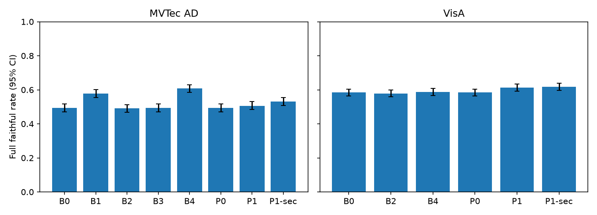

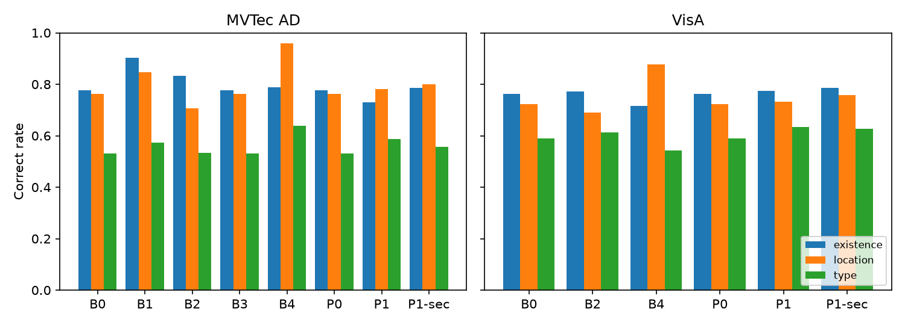

### Can trust be judged without ground truth?

The external verification score (P0) ranks fully faithful explanations above the rest better than the VLM's confidence (B0 to B2) and self-verification (B3) on both datasets. The VLM's own confidence is only slightly above chance, and self-verification is close to chance.

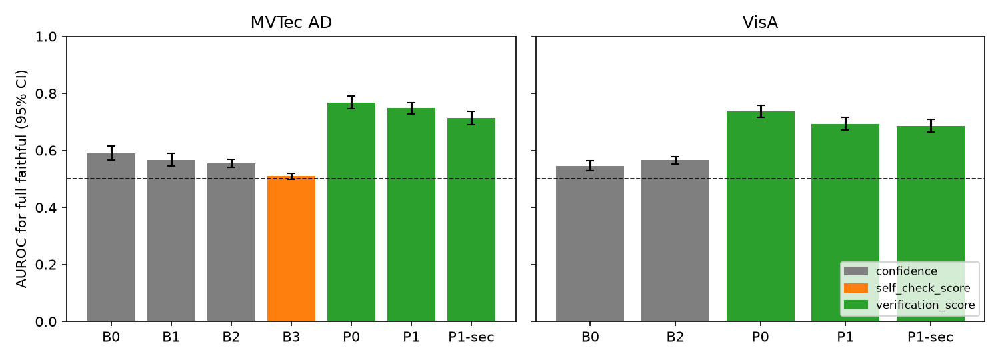

On MVTec AD both conditions of the A2 criterion hold in the main analysis: the lower bound of the P0 AUROC is above chance and the lower bound of its paired difference from B3 is above zero. Example-library seeds 1 and 2 give a narrow range in the same direction.

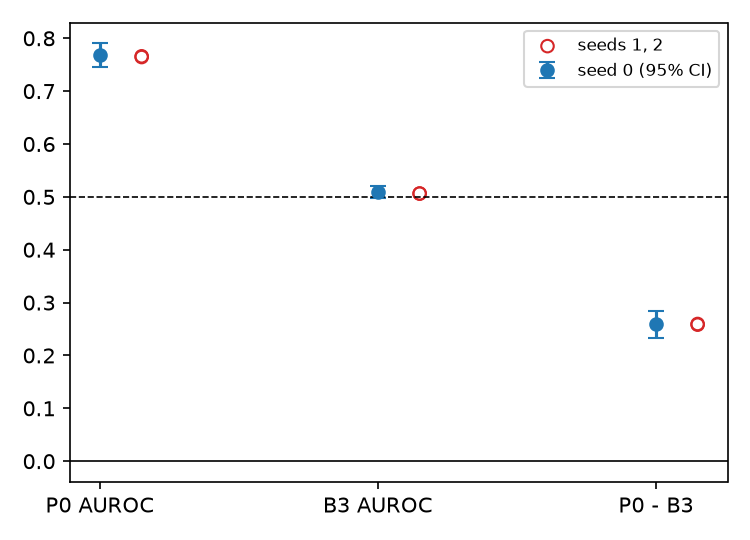

Explanations whose claims all pass verification are faithful more often than partly verified ones, which in turn beat withheld ones.

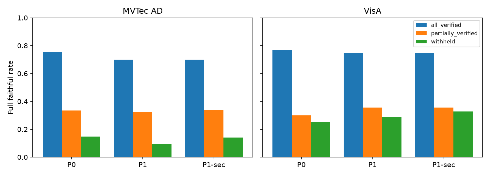

Removing the anomaly map costs the most discriminative power, the example library the next most. The tools share the anomaly map, so their contributions are not fully separable.

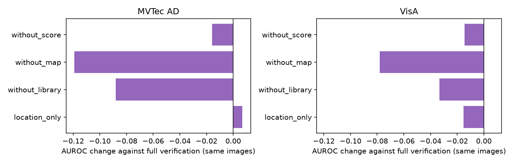

### Does the zoom-in re-query fix explanations?

Re-querying raises the full faithful rate of the re-queried images, but it also breaks some explanations. Always adopting the answer (P1) improves the overall rate only on VisA; adopting it only when the re-verification score rises (P1-sec) breaks fewer explanations. The verification score loses some discriminative power after re-query.

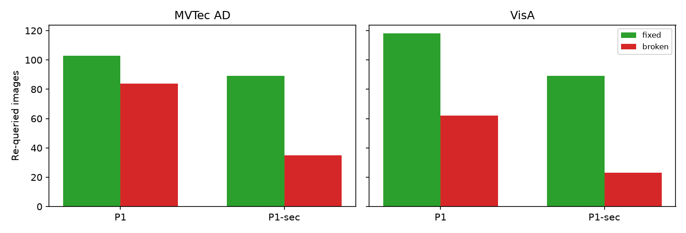

### Per category

The advantage of the verification score over confidence and self-verification holds across both datasets; the comparison with the detector template (B4) and the re-query effect depend on the dataset.

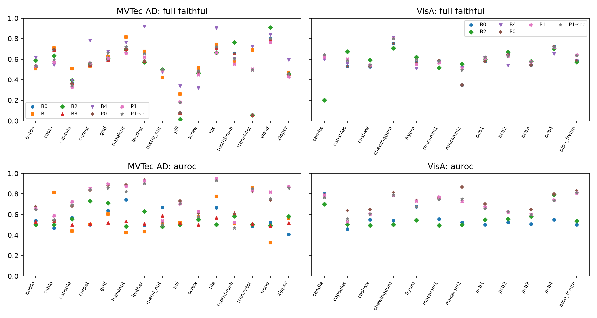

### Post-hoc experiment: out-of-grid cell answers

On VisA the VLM sometimes answered a fourth grid column. Drawing the grid on the image removed these answers, while the share of images read as four or more object columns was the same for violating and control images. This supports the missing-grid-reference explanation over object-column confusion. Clipping the violating answers back into the grid made only some of them fully faithful, so counting format violations as not faithful did not distort the main analysis much.

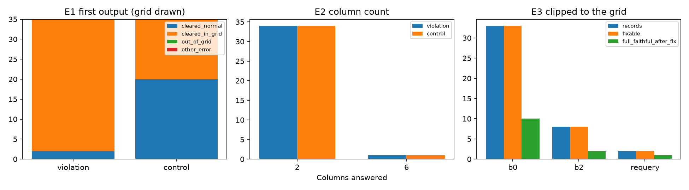

### Extension: a second VLM and a grid overlay

Planned and frozen in `configs/extension/plan.yaml` before the extension runs. With GLM-4.6V-Flash, the verification score again beat the VLM's confidence on both datasets and met the A2 criterion on MVTec AD (H5). Its self-verification answered every claim as true, so beating it equals beating chance. The filtered re-query (P1-sec) raised the full faithful rate over B0 and fixed more explanations than it broke on both datasets (H8), with a small gain.

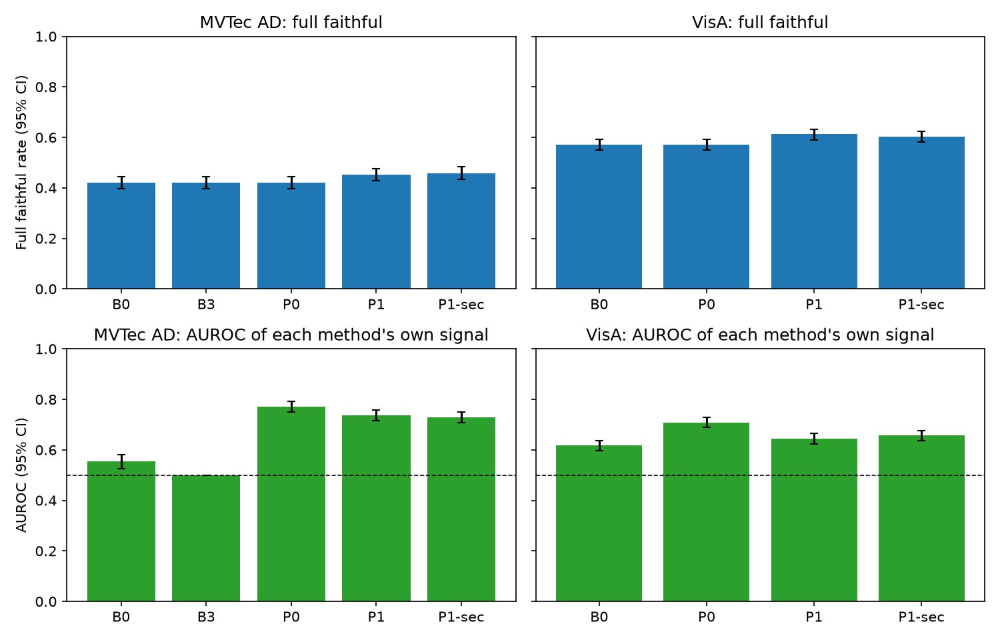

Exploratory (H9, Qwen only): drawing grid lines on the image (B0-grid) removed out-of-grid answers on both datasets and kept the verification power within the margin. Location accuracy cleared the bar only on MVTec AD, and the existence accuracy could not be shown to stay within the margin.

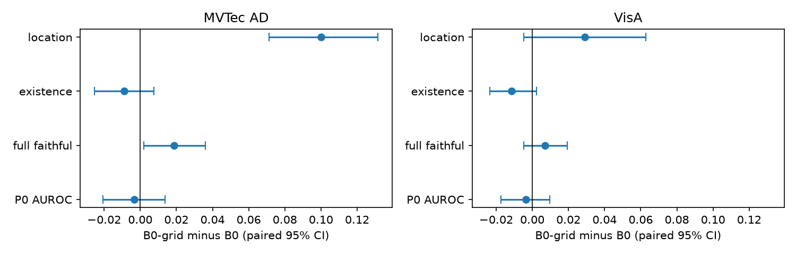

### Limitations

Two public benchmarks, two VLMs (4-bit, greedy, thinking off) and one detector (AnomalyCLIP); verification quality is bound to the detector. Location is a coarse invisible 3×3 grid. The re-query gain is small, and choosing the filtered re-query as the extension's primary analysis was decided after seeing the main results (before the second VLM's results). Rule values are pre-set starting points without sensitivity analysis, and intervals are not corrected for multiple comparisons.

## What is in this repository

| Path | Contents |
| --- | --- |
| `src/clave_ad/` | Shared code: data loaders, detector wrappers, prompts and parsing, claim decomposition, verifiers, re-query, baselines (B0 to B4), evaluation |
| `configs/<stage>/` | Frozen settings, rules and prompts per stage |
| `scripts/<stage>/` | Entry points per stage |
| `notebooks/kaggle/` | Kaggle kernels (two T4 GPUs) per stage |
| `results/<stage>/` | Result files with commit, config hash, environment and metrics |
| `docs/figures/` | Result figures generated by `scripts/analysis/report.py` |

Ground-truth masks and test labels are read only in `src/clave_ad/eval/`, with one exception: `src/clave_ad/library/` reads test labels and masks to draw the format-check sample and the example library (single-type defect test images, excluded from evaluation) and outputs only image paths and type names. The generation, verification and re-query paths never read ground truth; the verifiers use only detector outputs computed from the input image, normal training images for thresholds, and the example library, whose crops are cut from anomaly maps, not masks.

## Stages

| Stage | Main result file |
| --- | --- |
| Memory test (T4) | `results/memory_test/` |
| Format check and rule freeze | `results/format_check/` |
| Main run, MVTec AD and VisA | `results/main_run/vlm_s1..s4_*.json` |
| Evaluation | `results/analysis/eval_20261017T135021Z.json` |
| Post-hoc experiment: out-of-grid cell answers | `results/posthoc/posthoc_20261018T004519Z.json` |
| Extension: second VLM, filtered re-query, grid overlay | `results/extension/eval_extension_20261019T110149Z.json` |

Rules and prompts were committed before the results they govern were seen. The evaluation rules are in `configs/analysis/eval.yaml`, and the extension plan and hypotheses are in `configs/extension/plan.yaml`.

## Models and tools

- VLMs: Qwen/Qwen3.5-9B (main), zai-org/GLM-4.6V-Flash (extension), both 4-bit NF4 with greedy decoding and thinking off
- Detector: AnomalyCLIP official code and public weights at a pinned commit (not vendored), each weight trained on the other dataset
- Type verifier: OpenAI CLIP ViT-L/14@336px image encoder

Model revisions and checkpoint hashes are pinned in `configs/`.

## Reproducing

### GPU inference on Kaggle

GPU work (memory test, format check, detector, VLM sessions, post-hoc and extension runs) runs as private Kaggle kernels on two T4 GPUs. `scripts/kaggle/push.sh` uploads the committed code (`git archive HEAD`) as a private dataset, uploads any stage data packed under `cache/kaggle_data/<data_stage>/` as private datasets, and pushes the stage kernel `notebooks/kaggle/<stage>.py`:

    # commit first: the script refuses a dirty working tree
    KAGGLE_USERNAME=<kaggle-username> sh scripts/kaggle/push.sh <stage> [data_stages] [kernel_slugs]

`kernel_slugs` attaches the outputs of earlier kernels (for example the detector kernel). The Kaggle CLI must be installed and authenticated. Each kernel writes per-request caches and a result file; download the kernel output, then copy the result file into `results/<stage>/`. Interrupted runs resume from the cache.

### Analysis on CPU

    pip install -r requirements-analysis.txt
    python scripts/analysis/evaluate.py --config configs/analysis/run.yaml
    python scripts/extension/evaluate.py --check
    python scripts/extension/evaluate.py --config configs/extension/eval_run.yaml

`--check` verifies, without ground truth, that every extension request resolves to a cached answer and that the verification scores match the session results. Evaluation needs the datasets, the detector outputs and the generation caches, which are not distributed here (see Data), so these commands start but stop at the first missing input in a fresh clone. `requirements-analysis.txt` pins the local analysis environment; GPU kernels use the Kaggle image with the versions recorded in each result file.

## Data

This repository contains no images. Obtain the datasets from their sources:

- MVTec AD: CC BY-NC-SA 4.0 (non-commercial)
- VisA: CC BY 4.0

This work was done for non-commercial academic research only.

## License

Code: MIT. Datasets, models and the AnomalyCLIP code keep their own licenses: MVTec AD CC BY-NC-SA 4.0, VisA CC BY 4.0, Qwen3.5-9B Apache-2.0, GLM-4.6V-Flash MIT, AnomalyCLIP MIT, CLIP MIT.
